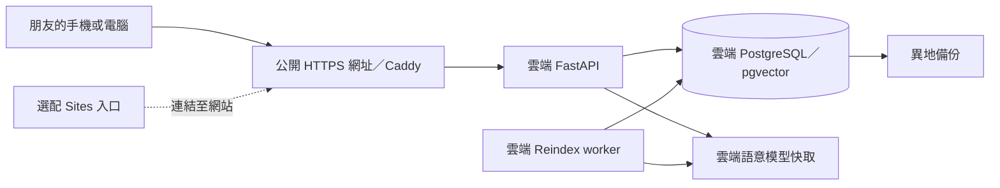

# 寶可夢人格推薦系統：上網部署流程與回家接續

整理日期：2026-11-02（台北時間）

專案：[likaisuwork9616/pokemon-personality-recommender](https://github.com/likaisuwork9616/pokemon-personality-recommender)

目前檢查的 Git commit：`25faaed8ccff3d9c069a1c589a9297d77ad23ff7`

這份文件供回家後接續實作使用。目標是讓別人透過 HTTPS 網址測試完整專案，而且自己的電腦關機後仍可使用。目前完成本機建置與部署規劃；尚未建立雲端主機、雲端資料庫或發布 Sites 網站。

## 1. 資料可以直接放在網站上嗎？

可以放在雲端，但要分清楚「網頁檔案」、「資料庫」與「執行推薦的後端」。

| 部分 | 現在的位置 | 上線後的位置 |
| --- | --- | --- |
| 網頁與 API | 這台電腦的 FastAPI | 雲端主機上的 FastAPI |
| 寶可夢、MBTI、向量與回饋 | 這台電腦的 PostgreSQL／pgvector | 雲端 PostgreSQL／pgvector 與持久磁碟 |
| 中文語意模型 | 本機 Hugging Face 快取 | 雲端模型快取 volume |
| Reindex worker | 本機背景程序 | 雲端常駐 worker |
| 圖片 | 既有 CloudFront URL | 確認沿用或更換為核准的圖片來源 |

**把後端、資料庫與模型都搬上雲端後，自己的電腦關機不會中斷網站。** 只把網頁上傳，或只把資料庫搬走，仍無法讓整套本機服務獨立運作。雲端主機本身也必須持續開機，資料磁碟必須保留。

Sites 可以保存雲端資料，支援 D1 與 R2；不過 D1 是 SQLite 相容資料庫，無法直接當作目前 PostgreSQL／pgvector 的替代品。本專案也需要 Python／PyTorch、語意模型與背景 worker，不能把現有 Docker Compose 原樣放進 Sites 的執行環境。[Sites 官方說明](https://learn.chatgpt.com/docs/sites)、[資料與連線](https://learn.chatgpt.com/docs/sites/data-and-connections)

若要完全改用 Sites 內建環境，必須另外規劃推薦引擎、資料存取與 worker 的改寫；這與部署現有完整專案是兩個工作。

## 2. 建議採用的架構

第一階段先讓現有專案完整部署到一台能執行 Docker 的 Linux 雲端主機，沿用 PostgreSQL 16／pgvector。第二階段再決定是否需要 Sites 入口。



這個方案保留目前的 Top 3 推薦、圖鑑證據、本機繁中解說、今日寶可夢、圖鑑、SQL MBTI 編輯、後台、回饋及背景索引。

如果之後希望所有操作都在 `chatgpt.site` 網址內完成，可以再做 Sites HTTP proxy。但必須額外驗證管理 cookie、CSRF／Origin、轉送來源位址、限流與靜態資源網址，不能只換 API URL 就宣告完整相容。先使用 Sites 連結到已部署網站，能較快取得可測試的完整版本。

臨時 Cloudflare Tunnel 可在電腦開著時分享測試，電腦關機就中斷。它不作為本計畫的持續上線方案。

## 3. 已完成的本機成果

目前工作目錄：`E:\kai_work\kai自己的\pm\pokemon-personality-recommender`。

| 項目 | 狀態 |
| --- | --- |
| Python 3.12 venv、CPU PyTorch、專案套件與 AWS 工具 | 已安裝 |
| PostgreSQL 16.15／pgvector 0.8.7 | 已建置 |
| 寶可夢資料 | 1,025 隻 |
| 圖鑑 chunks／ready vectors | 各 4,684 筆 |
| MBTI SQL catalog | 16 型、256 個加權詞，已啟用 `database` 來源 |
| Alembic revision | `20261012_0011` |
| API、worker、Prometheus、Grafana、Alertmanager | 已完成本機啟停及連線驗證 |
| 完整測試 | 前次 333 項通過，包含 PostgreSQL 整合測試 |
| 實際功能驗證 | 推薦排序可重現、本機證據解說、今日寶可夢、管理登入／登出、監控連線通過 |
| 外部 AI keys | 未設定，使用本機解說 |
| Docker | 目前這台電腦未安裝；本機採 Windows 原生程序 |
| 雲端部署 | 尚未執行 |

操作方式見 [Windows 本機環境](windows-local.md)。`.local/verification.json` 保存前次本機驗證結果；它不是雲端驗收報告。

## 4. 回家後取得這次修改

本次文件與本機環境腳本一併由 GitHub 的 `main` 分支同步。回家若已經有這個 repository，先確認自己的未提交修改，再執行：

```bash
git switch main
git pull --ff-only origin main
```

若還沒下載專案，執行：

```bash
git clone https://github.com/likaisuwork9616/pokemon-personality-recommender.git
cd pokemon-personality-recommender
```

如果 `--ff-only` 因本機另有 commit 而停止，先檢查兩邊差異並保留自己的工作；不要使用強制重設來覆蓋。

本次同步的檔案：

- `.dockerignore`
- `scripts/load_env.ps1`
- `scripts/local_database.ps1`
- `scripts/local_stack.ps1`
- `docs/windows-local.md`
- `docs/README.md`
- 本文件 `docs/上網部署流程與回家接續.md`

本次部署檢查已補上 `.dockerignore` 對 `.local/`、`*.dump`、`*.dump.sha256`、`*.bak` 的排除，避免把本機資料庫、模型快取與備份帶進 Docker image。相關既有部署／隱私測試共 15 項通過；尚未在這台電腦執行 Docker build。

Git 只同步程式與文件，**不會安裝另一台電腦的套件，也不會帶入 `.env`、`.venv/`、資料庫、模型快取或私鑰**。換到另一台電腦時，依 README 的 Docker 路徑，或依 Windows 本機文件重建環境。回家若只是從空庫建立相同的預設內容，可以重新 seed 及產生向量，不必複製 Windows 的整個 PostgreSQL 資料目錄。

若已新增個人資料、修改 MBTI 或修改寶可夢，改採 `pg_dump` 備份與 `pg_restore` 還原，並另行安全傳送備份。不要把正在運行的 Windows cluster 目錄直接拷進 Linux。

## 5. 開始上線前要決定的資料

回家後先補完這張表，再建立付費資源。

| 項目 | 待填內容 |
| --- | --- |
| 雲端平台與主機 | 尚未選擇 |
| 每月預算上限／幣別 | 尚未設定 |
| 主機區域 | 依主要測試者位置選擇 |
| SSH 使用者、主機位址與金鑰位置 | 尚未提供；不把私鑰內容貼進聊天或文件 |
| 對外網域或子網域／DNS 管理方式 | 尚未提供 |
| GitHub／GHCR 發布權限 | 待確認 |
| 圖片 CDN | 確認是否沿用目前目錄，或提供自己的來源 |
| 資料移轉方式 | 全新 seed，或還原本機備份 |
| 異地備份位置 | 尚未設定 |

起始容量規劃：`linux/amd64`、Ubuntu LTS、約 2 vCPU、8 GB RAM、至少 40–50 GB SSD。這是供完整 stack 首次部署的工程起點，並非量測後的容量保證；README 提到約需 4 GB **可用**記憶體，還要為作業系統、worker、模型建置與監控保留空間。先實測再調整。

主機、磁碟、備份與流量是否計費，要依所選平台當時方案確認。本計畫不承諾免費常駐；避免選會休眠或不保留磁碟的方案來當作持續可用環境。

## 6. 第一階段：先修好可重複部署流程

以下是下一次實作要完成的工作，不是已完成的部署。

### 6.1 檢查程式與建置內容

1. 讀取目前分支的差異，保留既有 Windows 環境成果。
2. 確認 `.dockerignore` 已排除本機資料與秘密；本次已補上相關規則。
3. 在可執行 Docker 的環境建立 Linux image，確認 requirements 與 CPU PyTorch 能安裝。
4. 確認 source、image 與 Git commit 對得上，保留 immutable image digest。

### 6.2 補齊 MBTI SQL 初始化與部署變數

目前 `scripts/production/deploy.sh` 只有 migrate → seed → embed，沒有初始化 MBTI SQL catalog。`.github/workflows/release.yml` 也尚未將 `MBTI_CATALOG_SOURCE` 傳入 deploy job。

要保留目前後台的 MBTI 編輯能力，需要：

- 正式環境設定 `MBTI_CATALOG_SOURCE=database`。
- 空庫第一次部署，在 migration 後顯式執行 `python -m scripts.mbti_catalog initialize`，再執行 `verify`。
- 已初始化的資料庫只做 `verify`；`initialize` 第二次執行會拒絕覆寫，不能把它當成每次重啟必跑的步驟。
- 若還原備份已包含完整 SQL catalog，直接驗證，不能重新初始化。
- 自動部署流程應區分「初次初始化」與「既有庫驗證」，有資料但驗證失敗時停止部署並查原因。

### 6.3 選擇 image 發布與部署入口

建議先手動完成第一版，再接自動部署。

現有 `release.yml` 的 build job 可以產出 GHCR image，但 deploy job 需要帶有 `pokemon-production` 標籤的 self-hosted runner。若尚未準備 runner，不要把完整 release workflow 當成可直接完成部署的按鈕。

下一次可先拆出 build-only GitHub Actions workflow，產出 `ghcr.io/...@sha256:...`，由 SSH 登入雲端主機執行部署。手動部署不需要 self-hosted runner。待第一版驗收後，再設定受保護的 GitHub `production` Environment 與 runner。

`deploy.sh` 要求 immutable `@sha256` image；不能直接拿本機 mutable tag 代替。

## 7. 第二階段：建立雲端主機與 HTTPS

1. 建立 Linux 主機與持久磁碟，確認預算、SSH 登入及主機重啟方式。
2. 安裝 Git、Python 3、Docker Engine 與 Compose v2，依 [Docker Ubuntu 官方文件](https://docs.docker.com/engine/install/ubuntu/) 操作。
3. 取得本專案「包含本次修改」的 Git 分支／commit。
4. 將網域 DNS 指向主機，確認 Caddy 能使用 80／443 完成 TLS。
5. 沿用 `compose.production.yml` 的公開邊界：Caddy 對外、PostgreSQL 不發布 host port；監控只綁 loopback，管理監控時使用 SSH tunnel。
6. 準備 repository 外的環境檔、備份目錄與 deploy state 目錄。

建議位置示例：

```text
/opt/pokemon-personality-recommender/   # 原始碼
/etc/pokemon-recommender/              # production.env、Alertmanager 設定
/var/backups/pokemon-recommender/      # 本機備份，另需異地副本
/var/lib/pokemon-recommender/deploy-state/
```

將 `.env.production.example` 複製成主機上的私密環境檔後填寫，不能直接複製目前 Windows `.env`。Windows 的 `HF_HOME`、路徑、55432 開發 port 與本機密碼不應原樣搬到正式環境。

主要設定：

| 變數 | 用途 |
| --- | --- |
| `PUBLIC_DOMAIN`、`ACME_EMAIL` | 對外網域與 Caddy TLS |
| `APP_IMAGE` | 已發布的 immutable GHCR digest |
| `POSTGRES_DB`、`POSTGRES_USER`、`POSTGRES_PASSWORD` | 雲端資料庫 |
| `ADMIN_PASSWORD`／`ADMIN_ACCOUNTS_JSON` | 管理員與角色 |
| `ADMIN_SESSION_SECRET` | 至少 32 個隨機字元 |
| `MBTI_CATALOG_SOURCE=database` | 啟用 SQL MBTI 編輯 |
| `GRAFANA_ADMIN_PASSWORD`、`ALERTMANAGER_CONFIG_FILE` | 監控登入與告警設定 |
| `POKEMON_ARTWORK_BASE_URL` | 明確指定沿用或更換後的圖片來源 |
| `POKEMON_BACKUP_DIR`、`POKEMON_DEPLOY_STATE_DIR` | 備份與部署狀態 |

首次仍將 Gemini／OpenAI keys 留空，先驗證本機解說。正式 Compose 已將管理 cookie 設為 Secure，必須以 HTTPS 驗證登入。

## 8. 第三階段：第一次建立雲端資料與服務

以下是 **Linux 雲端主機上** 的執行順序示例。需先完成 image、網域、環境檔及前述部署缺口；這些命令尚未在雲端執行。

先載入環境檔，之後所有維運命令都使用同一組設定：

```bash
cd /opt/pokemon-personality-recommender
set -a
. /etc/pokemon-recommender/production.env
set +a

docker compose -f compose.production.yml config --quiet
docker compose -f compose.production.yml config --format json \
  | python3 scripts/production/audit_compose_exposure.py
```

採用全新 seed 的順序：

```bash
docker compose -f compose.production.yml pull api worker migrate seed embed
docker compose -f compose.production.yml up -d db
docker compose -f compose.production.yml run --rm migrate
docker compose -f compose.production.yml run --rm seed

# 只用於空白、尚未初始化 MBTI catalog 的資料庫
docker compose -f compose.production.yml run --rm migrate \
  python -m scripts.mbti_catalog initialize
docker compose -f compose.production.yml run --rm migrate \
  python -m scripts.mbti_catalog verify

docker compose -f compose.production.yml run --rm embed
docker compose -f compose.production.yml up -d \
  api worker alertmanager prometheus grafana caddy
docker compose -f compose.production.yml ps --all
```

若採還原本機備份，先把備份還原到獨立的空白雲端測試庫，確認 PostgreSQL／pgvector 相容性、schema、模型版本與資料量，再決定切換。不要把「restore」與「全新 seed／initialize」不加區分地連續執行；既有 importer 可能以 CSV 更新內容。

模型首次下載與 4,684 段向量建立需要時間。讓 seed／embedding 成功完成、API ready 後，才將網址交給測試者。

## 9. 第四階段：驗收別人真的可以使用

### 系統與資料

- [ ] HTTPS 憑證正常，HTTP 轉 HTTPS，沒有 mixed content。
- [ ] `/health/live`、`/health/ready` 正常。
- [ ] 初次未修改資料時，有 1,025 隻寶可夢、4,684 個 ready vectors、16 型 MBTI 與 256 個詞。
- [ ] `mbti_catalog verify` 成功，公開 catalog 的 `source` 是 `database`。
- [ ] API、worker、DB 及監控持續運作；Prometheus scrape 為 `up`。
- [ ] 公開 `/metrics` 回傳 404，PostgreSQL 與監控管理 ports 沒有對外開放。

### 使用者與管理功能

- [ ] 相同個性描述得到穩定 Top 3，證據引用正確，缺少外部 key 時仍有繁中解說。
- [ ] 選填 MBTI、今日寶可夢、圖鑑搜尋／篩選、詳情與圖片正常。
- [ ] 管理登入／登出、SQL MBTI 編輯及 Audit Log 正常。
- [ ] Reindex 工作可以完成，舊索引在新版 ready 前仍可使用。
- [ ] 匿名回饋可提交，限流符合預期；測試收據與真人回饋分開判讀。
- [ ] 手機使用行動網路，可直接打開網址操作。

### 「關機仍可用」的最後測試

1. 完全關閉自己的電腦。
2. 用另一台設備與另一條網路打開公開網址。
3. 實際提交一筆推薦，不能只確認首頁圖片打得開。
4. 重新啟動雲端主機，確認服務恢復、資料量與管理修改仍在。

公開 smoke test 可沿用：

```bash
python3 scripts/production/smoke_test.py \
  --base-url "https://${PUBLIC_DOMAIN}"
```

## 10. 第五階段：備份與更新

1. 使用既有 `scripts/production/backup_postgres.sh` 產生 custom-format 備份及 SHA-256。
2. 另存一份到主機以外的位置，避免只靠同一台 VM 的磁碟。
3. 先在獨立資料庫演練還原並核對資料；restore 腳本會覆寫目標資料庫，需要明確的覆寫參數。
4. 更新前保留目前與前一版 image digest；migration 應維持與前版程式相容。
5. `rollback.sh` 只回退程式 image，不會自動回退資料庫 schema。
6. 保留 PostgreSQL 與模型 volumes；一般停機不要執行刪除 volumes 的指令。

操作細節見 [正式部署、備份與回退](production.md)。

## 11. Sites 的後續選項

等雲端後端正常後，再選擇：

| 選項 | 工作內容 | 適合用途 |
| --- | --- | --- |
| 直接分享雲端網址 | 不增加 Sites | 最快測試完整專案 |
| Sites 做入口與介紹 | 連結到雲端網站 | 想保留 GPT Sites 展示頁 |
| Sites 做同源 HTTP proxy | 額外實作及驗證 cookie、Origin、限流、資源路徑 | 希望在 Sites 網址內使用 |
| 完整改寫成 Sites 原生應用 | 重做資料庫、模型執行、索引與後台 | 未來另立遷移專案 |

無論入口是否使用 Sites，完整原版的雲端後端都不能再依賴本機 `localhost` 或本機 tunnel。

## 12. 回家後可直接貼給 Codex 的接續提示詞

```text
請先閱讀此專案 docs/上網部署流程與回家接續.md、docs/production.md，
並檢查目前 Git 分支與未提交修改。

我要將 pokemon-personality-recommender 完整部署到雲端，
讓別人直接測試，而且我的電腦關機後仍可使用。
保留 Python／SentenceTransformer、PostgreSQL／pgvector、worker、
SQL MBTI 編輯與既有推薦排序，先完成獨立雲端網站，再評估 Sites 入口。

請從「第一階段：可重複部署流程」接續，特別確認：
1. .dockerignore 沒有把 .local、秘密與備份帶進 image。
2. 初次 MBTI SQL initialize、後續 verify，以及 database 來源傳遞正確。
3. 若未設 self-hosted runner，先準備 build-only GHCR image 流程與手動部署。
4. 完成 HTTPS、實際推薦、管理寫入、重啟、備份還原與本機關機後的驗收。

雲端平台／主機：待填
每月預算上限與幣別：待填
SSH 主機、使用者、金鑰檔位置：待填（不貼私鑰內容）
網域與 DNS：待填
採用全新 seed 或還原本機資料：待填
Sites：完整雲端服務正常後再決定是否加入
```

## 參考文件

- [現有正式部署流程](production.md)
- [本機操作與環境變數](operations.md)
- [Windows 本機環境](windows-local.md)
- [MBTI SQL 資料來源與後台編輯](mbti-database.md)
- [費用護欄](cost-controls.md)
- [OpenAI Sites 官方說明](https://learn.chatgpt.com/docs/sites)
- [OpenAI Sites 資料與連線](https://learn.chatgpt.com/docs/sites/data-and-connections)
- [Docker Engine／Ubuntu 安裝](https://docs.docker.com/engine/install/ubuntu/)
